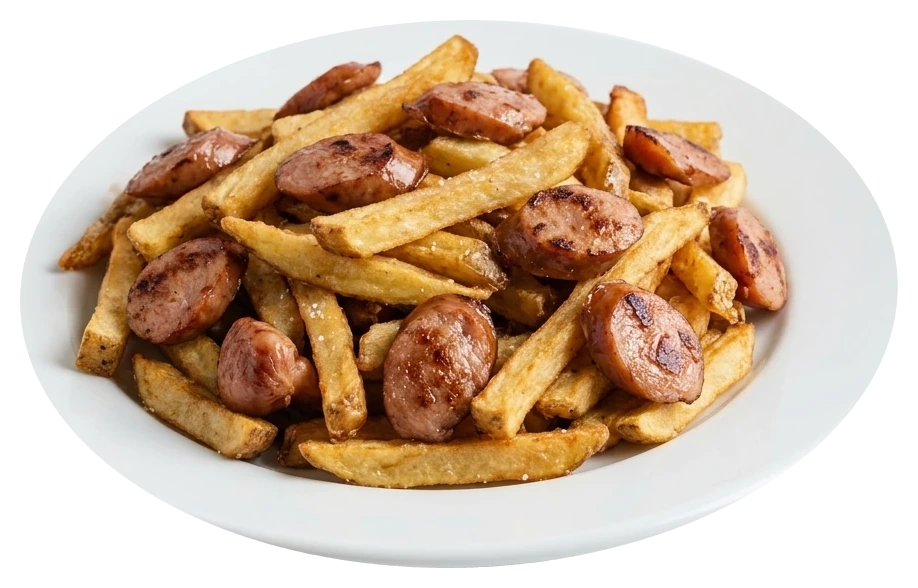
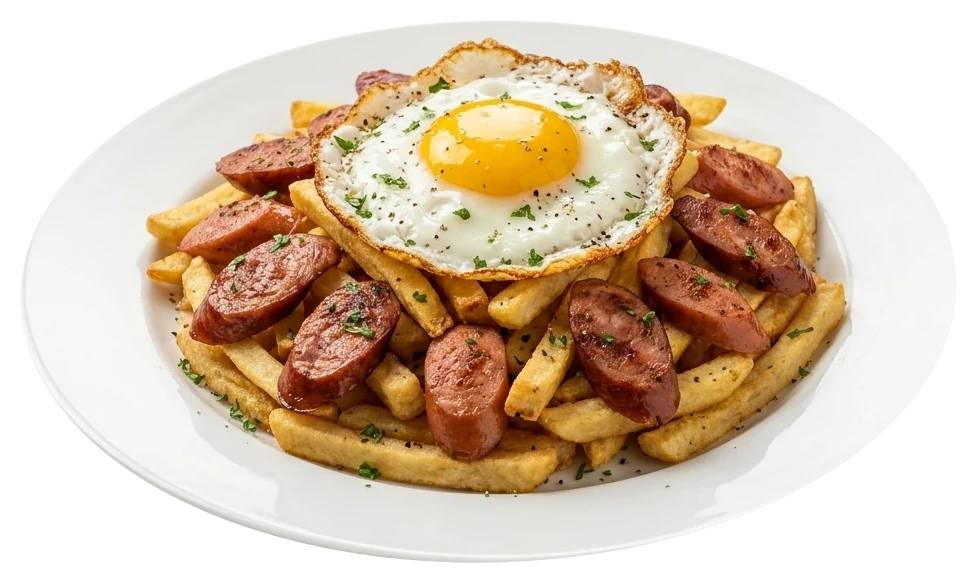
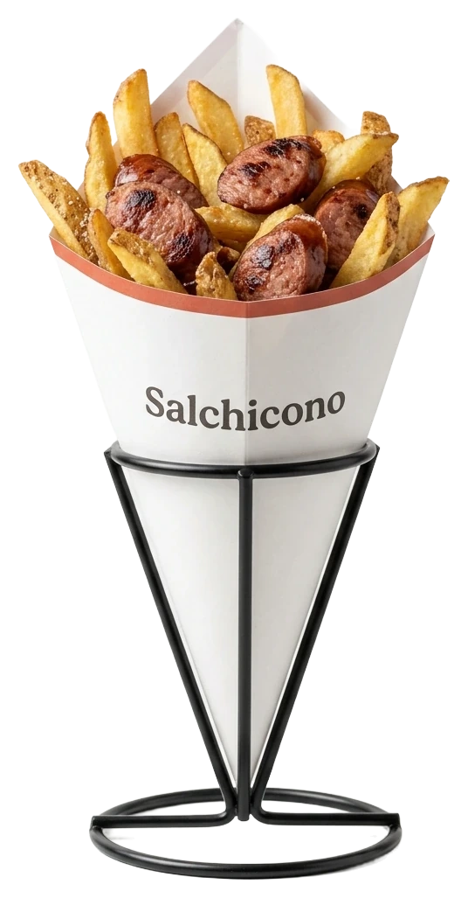
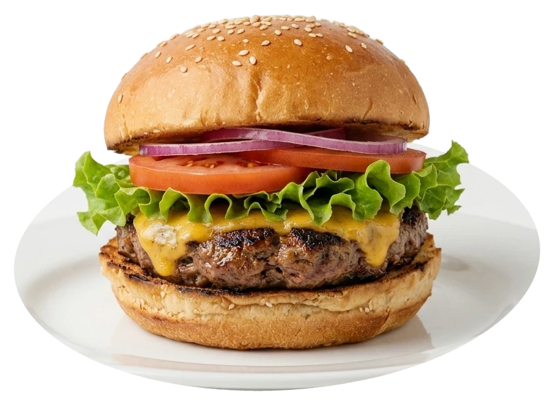
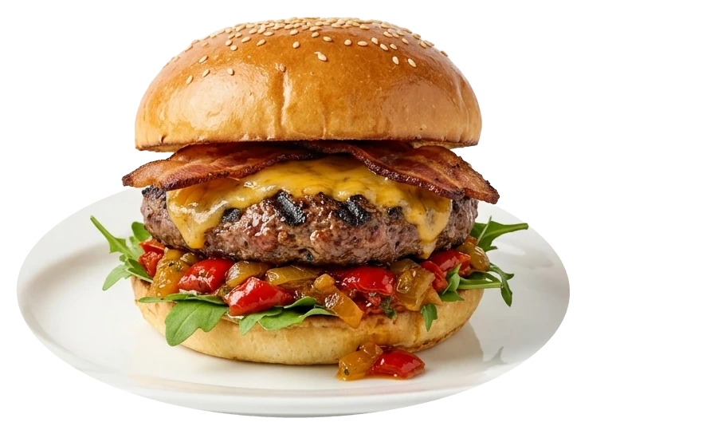
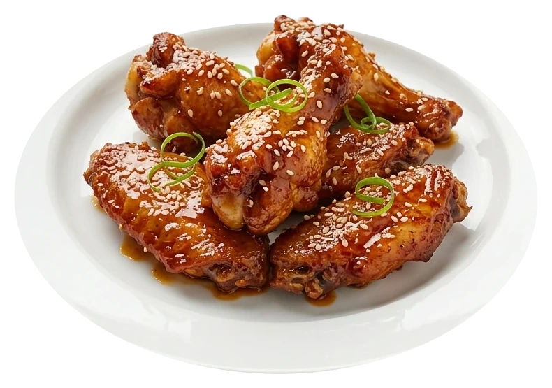
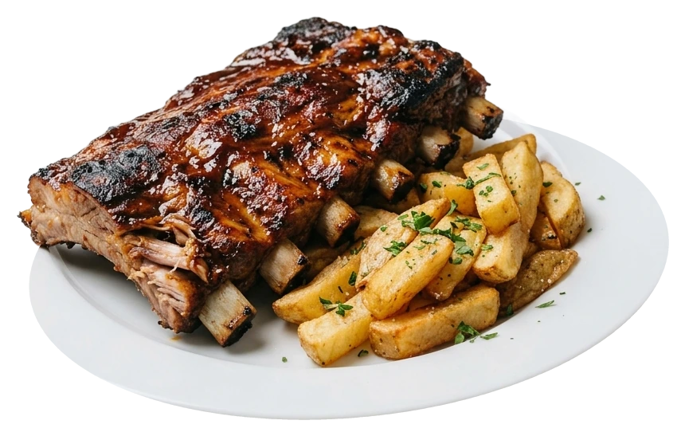

# Menú Oficial RedPepper — Catálogo Visual e Identidad de Productos

Este catálogo reúne los platillos del menú documentado de **RedPepper** (*Red Peppers Grill & Smoke*), fotografiados siguiendo el estándar de la skill oficial [`real-food-photography`](../skills/real-food-photography/SKILL.md) y exportados en formato **`.webp` con fondo transparente recortado limpio**, listos para usarse tanto en interfaces oscuras (POS) como en cartas digitales claras.

## Estándar Visual de la Carta

- **Platos servidos**: plato clásico redondo de porcelana blanca con porciones abundantes y bien contenidas.
- **Formato para llevar en cono**: cono blanco mate impreso con identidad *Salchicono* y acento rojo RedPepper, sostenido en portacono negro mate estándar.
- **Bebidas**: vaso cilíndrico liso transparente con hielo cristalino, fruta fresca y condensación fría real.
- **Autenticidad**: sellado a la brasa/ahumado natural, preparación al instante (sin precocidos) y textura real sin retoques plásticos.

---

## Carta Completa e Identidad de Cada Producto

### 1. Salchipapas y Conos

| Producto | Precio Ref. | Identidad y Valor Especial | Imagen (`.webp` transparente) |
|---|---:|---|---|
| **Salchipapa Clásica** | S/ 8.00 | **Clásico al instante**: papas nativas doradas y crocantes cortadas en bastones rústicos con sal fina, combinadas con rodajas gruesas de hot dog artesanal selladas a la plancha hasta lograr un sutil ahumado natural. |  |
| **Salchipapa Especial** | S/ 14.90 | **Firma de la casa**: doble porción abundante de papas nativas crocantes con rodajas gruesas de chorizo parrillero ahumado y hot dog artesanal, coronada con un huevo frito de bordes dorados crujientes, yema jugosa intacta y toque de perejil fresco picado. |  |
| **Salchicono** | — | **Formato urbano portátil**: porción generosa y llamativa de papas nativas doradas con rodajas gruesas de salchicha sellada y ahumada, presentada en el cono blanco impreso *Salchicono* con acento rojo sobre portacono negro mate. |  |

---

### 2. Burgers al Carbón

| Producto | Precio Ref. | Identidad y Valor Especial | Imagen (`.webp` transparente) |
|---|---:|---|---|
| **Hamburguesa Clásica** | S/ 8.00 | **Sabor directo a la brasa**: 140 g de carne magra con costra sellada al carbón, queso cheddar fundido naturalmente sobre los bordes, lechuga crespa fresca, tomate maduro y aros sutiles de cebolla roja en pan brioche dorado con mantequilla. |  |
| **Red Pepper Burger** | S/ 14.90 | **Insignia RedPepper**: jugosa carne Angus sellada a fuego vivo, queso cheddar derretido, tocino ahumado crocante, hojas frescas de rúcula y nuestro *relish* artesanal de pimiento rojo asado y ají amarillo peruano que le otorga color, carácter y frescura única. |  |

---

### 3. Alitas y Parrilla

| Producto | Precio Ref. | Identidad y Valor Especial | Imagen (`.webp` transparente) |
|---|---:|---|---|
| **Alitas Glazed x6** | S/ 16.50 | **Glaseado de autor**: seis alitas crujientes recién fritas, bañadas en una reducción brillante y espesa de maracuyá natural con ají panca ahumado, terminadas con ajonjolí tostado y finos aros de cebollita china fresca. |  |
| **Costillar BBQ Ahumado** | S/ 18.00 | **Ahumado lento al carbón**: medio costillar jugoso de cerdo ahumado lentamente, glaseado con salsa BBQ casera de ají panca caramelizada al fuego y acompañado de papas nativas doradas con perejil fresco. |  |

---

### 4. Bebidas Naturales (500 ml)

| Producto | Precio Ref. | Identidad y Valor Especial | Imagen (`.webp` transparente) |
|---|---:|---|---|
| **Refresco Pulpa Natural — Chicha Morada** | S/ 5.50 | **Frescura tradicional**: maíz morado *culli* con aroma sutil de piña y especias, servido helado en vaso liso transparente con hielo cristalino, rodaja de limón fresco y gotas reales de condensación fría. | *Pendiente por límite temporal de cuota en Nano Banana (`gemini-3.1-flash-image`) (prompt listo abajo).* |
| **Refresco Pulpa Natural — Maracuyá** | S/ 5.50 | **Pulpa fresca cítrica**: jugo natural de maracuyá con notas ácidas vibrantes, pequeñas semillas naturales auténticas, hielo abundante, hoja fresca de menta y condensación fría real en el vaso. | *Pendiente por límite temporal de cuota en Nano Banana (`gemini-3.1-flash-image`) (prompt listo abajo).* |

---

## Prompts Listos para Completar las 2 Bebidas Pendientes (Usando `real-food-photography`)

Cuando la cuota de `generate_image` (`gemini-3.1-flash-image`) se restablezca, ejecuta estos 2 prompts y exporta a `imagenes/*.webp` con fondo transparente siguiendo el Paso 5 de [`SKILL.md`](../skills/real-food-photography/SKILL.md):

1. **`imagenes/refresco-chicha-morada.webp`** (`AspectRatio: 3:4`)
   > Authentic commercial catalog beverage photography of a chilled 500ml Peruvian Chicha Morada natural drink, isolated on a clean, seamless matte white studio background with a flat horizontal surface. A single tall, straight-sided clear smooth drinking glass sits firmly flat in the center, filled to a strictly horizontal level with vibrant deep-purple maize culli chicha morada, crystal-clear irregular ice cubes floating near the top, one fresh bright-green lime wheel at the liquid surface, and fine cold condensation droplets beading down the glass exterior. Soft diffused daylight from the left with clean translucent backlight and grounded contact shadow, 85mm prime lens at f/6.3.

2. **`imagenes/refresco-maracuya.webp`** (`AspectRatio: 3:4`)
   > Authentic commercial catalog beverage photography of a chilled 500ml Peruvian Maracuyá natural pulp drink, isolated on a clean, seamless matte white studio background with a flat horizontal surface. A single tall, straight-sided clear smooth drinking glass sits firmly flat in the center, filled to a strictly horizontal level with sunny golden-amber natural passionfruit juice featuring a few authentic dark passionfruit seeds, crystal-clear irregular ice cubes, a fresh mint sprig and thin lime slice at the ice line, and fine cold condensation droplets beading down the glass exterior. Soft diffused daylight from the left with clean translucent backlight and grounded contact shadow, 85mm prime lens at f/6.3.
